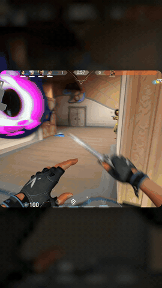
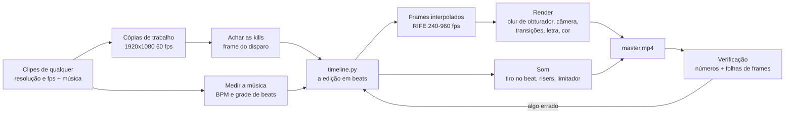
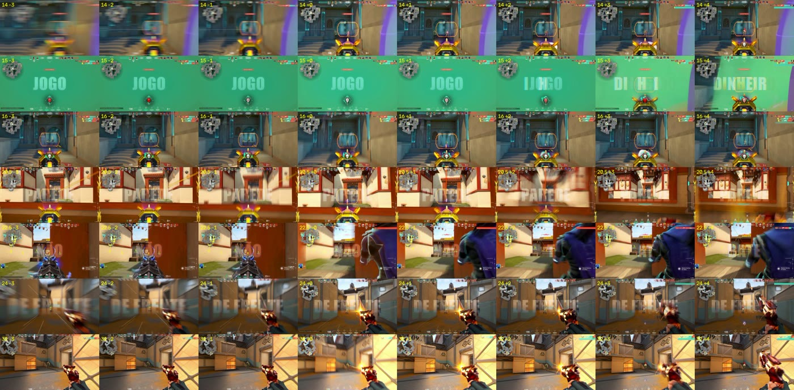

# Edit de gameplay no beat, feito pelo Claude Code

Uma skill do [Claude Code](https://docs.claude.com/en/docs/claude-code) que transforma clipes de Valorant, CS2 ou outro FPS e uma música num edit pronto para TikTok, Reels ou Shorts. Ela coloca cada kill no beat, faz slow motion suave com interpolação por IA, transições no grave da música ou no ritmo das kills (você escolhe), zooms curtos nas kills e palavras da letra na tela, e entrega até a capa.

Não usa editor de vídeo. O Claude escreve a edição num arquivo Python (`timeline.py`), um pipeline próprio monta cada frame, e o ffmpeg só lê e grava os vídeos.

| Estilo "referência" (horizontal, com letra) | Estilo "house" (vertical, janela) |
|---|---|
|  |  |

*Os GIFs têm 30 fps e 480 px; os vídeos de verdade saem em 60 fps e em resolução cheia.*

## O que você precisa

| Item | Detalhe |
|---|---|
| Windows 10/11 | Por enquanto só Windows: os comandos da skill usam Git Bash ([Git for Windows](https://git-scm.com/download/win): `winget install Git.Git`) e PowerShell |
| [Claude Code](https://docs.claude.com/en/docs/claude-code) | Quem roda a skill |
| Modelo | **Claude Opus 5.5 com pensamento no `max` (recomendado).** No `xhigh` também funciona, mas com desempenho inferior |
| Placa de vídeo com Vulkan | Usada na interpolação (RIFE). Serve NVIDIA, AMD ou Intel com o driver em dia; não precisa de CUDA. Testado numa GTX 1650 4 GB, Ryzen 5 5500, 16 GB de RAM. Notebook com duas placas: a skill explica como escolher a dedicada |
| [ffmpeg](https://www.gyan.dev/ffmpeg/builds/) | `winget install Gyan.FFmpeg` |
| [uv](https://docs.astral.sh/uv/) | Cria o Python 3.11 do projeto: `winget install astral-sh.uv` |
| Gravações de qualquer resolução e taxa | 1080p, 1440p, 4K, 4:3 esticado, ultrawide; de 30 a 240 fps (ShadowPlay, Outplayed, OBS, Medal). O ideal é 60 fps ou mais: a 30 fps metade dos frames tem que ser inventada. Pode ser clipe curto ou gravação crua de alguns minutos |
| Espaço em disco | De 7 a 13 GB por vídeo para os frames interpolados (dá para apagar depois). Some o tamanho das cópias convertidas quando os clipes não são 1920x1080 a 60 fps, ou estão em outro disco (aí eles são copiados, não linkados) |

## Instalar

```bash
git clone https://github.com/gustavomenani/editing-gameplay-montages.git
mkdir -p ~/.claude/skills
cp -r editing-gameplay-montages/skills/editing-gameplay-montages ~/.claude/skills/
```

No PowerShell:

```powershell
git clone https://github.com/gustavomenani/editing-gameplay-montages.git
New-Item -ItemType Directory -Force $HOME\.claude\skills | Out-Null
Copy-Item -Recurse editing-gameplay-montages\skills\editing-gameplay-montages $HOME\.claude\skills\
```

Para atualizar depois: rode `git pull` dentro da pasta clonada. A skill pede ao Claude que anote nela o que aprender nos seus projetos: se ele já anotou algo, guarde uma cópia de `~/.claude/skills/editing-gameplay-montages` antes de apagar essa pasta. Depois, volte à pasta de onde executou `git clone` e repita apenas os comandos de criação da pasta e cópia acima (`mkdir`/`cp` no Git Bash ou `New-Item`/`Copy-Item` no PowerShell). Os caminhos de origem desses comandos são relativos a essa pasta, não à pasta clonada.

O resto (venv, dependências Python, modelo RIFE) o Claude instala sozinho na pasta do projeto, seguindo a skill.

## Como pedir o vídeo

1. Coloque numa pasta os clipes e a música. **Recomendado:** coloque também um vídeo de referência, um edit que você curtiu (baixado do TikTok ou do YouTube). Com ele a skill copia os cortes, o ritmo, os efeitos e o texto.
2. Abra o Claude Code nessa pasta e peça o edit, do seu jeito:

```text
faz um edit pro tiktok com esses clipes e essa música
```

3. A skill responde primeiro com um briefing: pergunta o formato, a duração, a intensidade, se quer a letra na tela e a capa, quais jogadas abrem e fecham, qual parte da música e qual jogo, e dá dicas para o resultado ficar melhor. Responda tudo numa mensagem só. O que você deixar em branco ela decide sozinha.
4. Daí em diante ela não pergunta mais nada: trabalha e te entrega o vídeo.

Se o seu pedido já disser tudo, ela pula o briefing:

```text
edita esses clipes de valorant com a MESMA EDIÇÃO desse vídeo "VIDEO PARA COPIAR.mp4", 30 segundos, com a letra da música na tela, abrindo com o ace
```

Depois é ir ajustando como faria com um editor humano: "o slow motion tá travado", "sincroniza melhor as letras", "tira aquela kill da raze". Cada versão sai como um arquivo novo (`_v1`, `_v2`, ...) ao lado dos clipes, e as anteriores ficam.

Tempos medidos em vídeos de 37 a 46 segundos (GTX 1650): de 30 a 55 minutos de interpolação e de 12 a 16 minutos de render, os dois em segundo plano. Um ajuste que não mexe nos cortes só precisa de um render novo.

## Como funciona

A ideia central da skill: **o Claude não consegue ver nem ouvir o vídeo, então nada é feito "no olho".** Os frames são lidos pelo número, os beats são medidos na forma de onda, cada kill é presa ao frame do disparo, e cada render é julgado por números e por imagens que ele lê.



1. **Qualquer gravação vira o formato de trabalho.** 1440p, 4K, 4:3 esticado ou ultrawide, de 30 a 240 fps: cada clipe vira 1920x1080 a 60 fps. Quando um frame original cai no instante certo, ele é usado sem mexer (120 e 240 fps). Quando não cai, o RIFE cria o frame no instante exato (144 fps, por exemplo). Nunca se repete frame, e o som fica alinhado ao frame (0,000 ms de diferença medida).
2. **Frames pelo número.** Cortar com `-ss` e `fps=60` no ffmpeg duplicava 1 frame em cada 3 (era isso que o pessoal sente como "quedas de fps"). Todo frame é lido pelo índice.
3. **Kills em qualquer jogo.** A skill acha cada linha nova do kill feed e, olhando para trás, o tiro: no som (o estampido), na imagem (o clarão da arma) e no contador de munição. O frame que vai no beat é o do **disparo**, não o da linha do feed, que aparece de 5 a 12 frames depois. Há perfis de Valorant, CS2 e um genérico para qualquer outro jogo.
4. **Música.** Mede o BPM e refina a grade de beats contra os ataques do bumbo (o primeiro chute costuma vir uns 38 ms adiantado). As kills só vão em bumbo, caixa ou hi-hat forte que foram medidos. As transições vão onde você escolher no briefing: **no grave** (o padrão, mais fino, com menos cortes) ou **no ritmo das kills** (mais cortes, mais acelerado). No grave, a skill confere que nenhuma transição caiu fora dele.
5. **A edição é código.** `timeline.py` diz, em beats, qual frame de qual clipe aparece em cada momento. As rampas de velocidade são curvas suaves entre âncoras.
6. **Slow motion de verdade.** O RIFE cria frames intermediários (240 fps em tudo, 960 fps onde está lento). Cada frame final é a média dos subframes no tempo do obturador, o que dá motion blur real e nenhum engasgo.
7. **Som.** Cada tiro é colocado exatamente no beat. Depois vêm risers antes dos drops, whoosh nas transições do estilo house e um limitador. O AAC é gravado com PNS, TNS e intensity stereo desligados, porque com eles três versões saíram estourando.
8. **Verificação.** Antes de entregar, a skill mede frames repetidos, travadas, saltos, loudness e pico. Para cada kill ela monta uma folha dos frames −3 a +4: o clarão do tiro não pode aparecer no −1 e precisa começar no +0.



## Os dois estilos

| | Referência | House |
|---|---|---|
| Quando | Você manda um vídeo para copiar | Só clipes e música |
| Formato | 1920x1080, 60 fps, gameplay em tela cheia | 1080x1920, 60 fps, janela arredondada sobre um fundo desfocado que pulsa |
| Cortes | Corte seco no beat com 4 frames de blur (whip, zoom, giro) | Whip, spin, zoom-through, zcut; os dois clipes se mexem |
| Slow motion | 0.06 a 0.16x logo depois da kill | 0.28x só nos finalizadores |
| Texto | Palavra por palavra da letra, translúcida, no centro exato | Nenhum |
| Fim | Escurece pelas sombras primeiro | Fade para o preto |
| Extra | Capa com o título | |

## Estrutura

```text
skills/editing-gameplay-montages/
  SKILL.md              ponto de entrada: briefing, estilos, regras, passo a passo
  pipeline.md           instalação, scripts, tempos, como rodar jobs longos
  edit-design.md        estilo house: sequência, rampas, efeitos, transições, som
  reference-style.md    copiar um vídeo de referência, gravação crua, letra, capa
  verification.md       como julgar um render sem assistir
  pitfalls.md           sintoma -> causa -> solução de tudo que já deu errado
  tools-research.md     CapCut, Resolve, Remotion, MCPs: o que foi comparado
  scripts/              pipeline em Python (entrada de qualquer resolução/fps, render, som, música, kills, checagens)
  scripts/games/        perfis de jogo para achar kills (valorant, cs2, generic)
  scripts/refstyle/     arquivos do estilo referência (render com letra, kill feed, capa)
  models/rife-v4.25/    rede de interpolação (ncnn/Vulkan)
```

## Limitações

- O vídeo final sai em 1080x1920 (vertical) ou 1920x1080 (horizontal), a 60 fps.
- A detecção automática de kills foi medida no Valorant: achou 26 das 27 kills de referência e acertou o frame exato do disparo em 22 de 23. O perfil de CS2 foi montado a partir dos arquivos de HUD do jogo, mas ainda não foi testado em gravação real. O perfil genérico acha as linhas do kill feed (26 das 27 no mesmo teste), mas, sem a cor das suas kills e sem o contador de munição do jogo, erra o frame do disparo em sprays. Para outro jogo, o Claude cria o perfil dele olhando um frame. Em qualquer jogo ele confere cada kill nas folhas de revisão antes de usar.
- O estilo referência só gera 1920x1080. Uma referência vertical ainda não tem renderizador próprio.
- Os comandos de shell são de Windows (Git Bash e PowerShell).
- O Claude mede tudo, mas não assiste. Sensação, intensidade e mixagem quem julga é você.
- A letra na tela só aparece se cada linha for confirmada numa página de letras, porque o reconhecimento de voz erra metade de um verso de trap.
- O TikTok pode converter uploads de 60 fps para 30 fps se a opção de alta qualidade estiver desligada (não confirmado oficialmente).

## Contribuir

O projeto é aberto. Issues e pull requests são bem-vindos, principalmente para:

- validar o perfil de CS2 em gravações reais e criar perfis de outros jogos (Fortnite, Apex) para a detecção de kills;
- um renderizador vertical para o estilo referência;
- comandos equivalentes para Linux e macOS.

Toda mudança no pipeline deve vir com a medição que a justifica (`check.py`, folhas de sincronia), seguindo o princípio da skill: nada no olho.

## Créditos e licença

- Scripts e documentação: [MIT](LICENSE).
- Modelo de interpolação RIFE v4.25: [Practical-RIFE](https://github.com/hzwer/Practical-RIFE) (hzwer, MIT), convertido para ncnn em [rife-ncnn-vulkan](https://github.com/TNTwise/rife-ncnn-vulkan) (MIT). Binding Python: `rife-ncnn-vulkan-python-tntwise`.
- O repositório não traz música nem gravações. Os direitos das músicas e dos clipes que você usar são seus para resolver.
