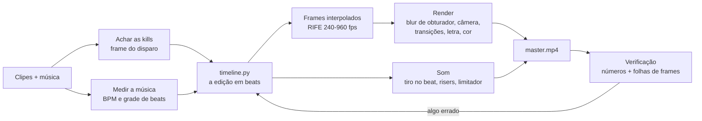

# Edit de gameplay no beat, feito pelo Claude Code

Uma skill do [Claude Code](https://docs.claude.com/en/docs/claude-code) que transforma clipes de Valorant (ou outro FPS) e uma música num edit pronto para TikTok, Reels ou Shorts. Ela coloca cada kill no beat, faz slow motion suave com interpolação por IA, transições, zooms curtos nas kills e palavras da letra na tela, e entrega até a capa.

Não usa editor de vídeo. O Claude escreve a edição num arquivo Python (`timeline.py`), um pipeline próprio monta cada frame, e o ffmpeg só lê e grava os vídeos.

| Estilo "referência" (horizontal, com letra) | Estilo "house" (vertical, janela) |
|---|---|
|  |  |

*Os GIFs têm 30 fps e 480 px; os vídeos de verdade saem em 60 fps e em resolução cheia.*

## O que você precisa

| Item | Detalhe |
|---|---|
| Windows 10/11 | Os comandos da skill usam Git Bash e PowerShell |
| [Claude Code](https://docs.claude.com/en/docs/claude-code) | Quem roda a skill |
| Placa de vídeo com Vulkan | Usada na interpolação (RIFE). Testado numa GTX 1650 4 GB, Ryzen 5 5500, 16 GB de RAM |
| [ffmpeg](https://www.gyan.dev/ffmpeg/builds/) | `winget install Gyan.FFmpeg` |
| [uv](https://docs.astral.sh/uv/) | Cria o Python 3.11 do projeto: `winget install astral-sh.uv` |
| Gravações em 1920x1080, 60 fps | ShadowPlay, Outplayed etc. Pode ser clipe curto ou gravação crua de 2 minutos |
| Espaço em disco | De 7 a 13 GB por vídeo (frames interpolados; dá para apagar depois) |

## Instalar

```bash
git clone https://github.com/gustavomenani/editing-gameplay-montages.git
cp -r editing-gameplay-montages/skills/editing-gameplay-montages ~/.claude/skills/
```

No PowerShell:

```powershell
git clone https://github.com/gustavomenani/editing-gameplay-montages.git
Copy-Item -Recurse editing-gameplay-montages\skills\editing-gameplay-montages $HOME\.claude\skills\
```

O resto (venv, dependências Python, modelo RIFE) o Claude instala sozinho na pasta do projeto, seguindo a skill.

## Como pedir o vídeo

1. Coloque numa pasta os clipes, a música (`.flac` ou `.mp3`) e, se quiser copiar um edit que você viu, o vídeo de referência.
2. Abra o Claude Code nessa pasta.
3. Peça em português mesmo:

```text
faz um edit pro tiktok com esses clipes e essa música, kills no beat, slow motion e transições
```

```text
edita esses clipes com a MESMA EDIÇÃO desse vídeo "VIDEO PARA COPIAR.mp4", com a letra da música na tela
```

```text
faz uma capa pro vídeo
```

Depois é ir ajustando como faria com um editor humano: "o slow motion tá travado", "sincroniza melhor as letras", "tira aquela kill da raze". Cada versão sai como um arquivo novo (`_v1`, `_v2`, ...) ao lado dos clipes, e as anteriores ficam.

Tempos medidos em vídeos de 37 a 46 segundos (GTX 1650): de 30 a 55 minutos de interpolação e de 12 a 16 minutos de render, os dois em segundo plano. Um ajuste que não mexe nos cortes só precisa de um render novo.

## Como funciona

A ideia central da skill: **o Claude não consegue ver nem ouvir o vídeo, então nada é feito "no olho".** Os frames são lidos pelo número, os beats são medidos na forma de onda, cada kill é presa ao frame do disparo, e cada render é julgado por números e por imagens que ele lê.



1. **Frames pelo número.** Cortar com `-ss` e `fps=60` no ffmpeg duplicava 1 frame em cada 3 (era isso que o pessoal sente como "quedas de fps"). Todo frame é lido pelo índice.
2. **Kills.** Em clipes curtos a skill acha o banner de kill do Valorant. Em gravações cruas ela acha o kill feed e o frame em que a munição cai. O frame que vai no beat é o do **disparo**, não o do banner, que aparece 3 a 4 frames depois.
3. **Música.** Mede o BPM e refina a grade de beats contra os ataques do bumbo (o primeiro chute costuma vir uns 38 ms adiantado). As kills só vão em bumbo, caixa ou hi-hat forte que foram medidos.
4. **A edição é código.** `timeline.py` diz, em beats, qual frame de qual clipe aparece em cada momento. As rampas de velocidade são curvas suaves entre âncoras.
5. **Slow motion de verdade.** O RIFE cria frames intermediários (240 fps em tudo, 960 fps onde está lento). Cada frame final é a média dos subframes no tempo do obturador, o que dá motion blur real e nenhum engasgo.
6. **Som.** Cada tiro é colocado exatamente no beat. Depois vêm risers antes dos drops, whoosh nas transições e um limitador. O AAC é gravado com PNS, TNS e intensity stereo desligados, porque com eles três versões saíram estourando.
7. **Verificação.** Antes de entregar, a skill mede frames repetidos, travadas, saltos, loudness e pico. Para cada kill ela monta uma folha dos frames −3 a +4: o clarão do tiro não pode aparecer no −1 e precisa começar no +0.


## Os dois estilos

| | Referência | House |
|---|---|---|
| Quando | Você manda um vídeo para copiar | Só clipes e música |
| Formato | 1920x1080, 60 fps, gameplay em tela cheia | 1080x1920, 60 fps, janela arredondada sobre um fundo desfocado que pulsa |
| Cortes | Corte seco no beat com 4 frames de blur (whip, zoom, giro) | Whip, spin, zoom-through, zcut; os dois clipes se mexem |
| Slow motion | 0.06 a 0.16x logo depois da kill | 0.28x só nos finalizadores |
| Texto | Palavra por palavra da letra, translúcida, no centro exato | Nenhum |
| Fim | Escurece pelas sombras primeiro | Fade para o preto |
| Extra | Capa com o título | |

## O gosto que vem embutido

A skill aprendeu com o feedback de quem a fez. Algumas regras viraram lei:

| Regra | Como foi pedido |
|---|---|
| Nada de zoom parado no vídeo todo; zoom só como acento curto | "voce deixou um zoom no video todo ... fica estranho" |
| Nada pode travar; slow motion perfeitamente liso | "o slow motion ta bem travadinho" |
| Kill exatamente no beat | "da pra sincronizar melhor" |
| O fim só escurece, sem zoom no ace | "no fim nao de um zoom no ace apenas deixe a tela escurecer" |
| Letras translúcidas, no meio da tela, uma palavra por vez | "as letras estavam sem transparencia alguma 100% solidas" |
| Nenhum texto além da letra | "tira esse valorant edit da tela" |
| Kill bonita = tiro limpo de longe, não o maior flick | "aquela kill da raze, é muito feia" |
| Não perguntar nada: decidir e contar depois | "nao me pergunte NADA" |

Para mudar o gosto, edite a seção **"What this user wants, in their words"** em `SKILL.md`. Os arquivos da skill estão em inglês porque são escritos para o agente. As respostas para você saem em português.

## Estrutura

```text
skills/editing-gameplay-montages/
  SKILL.md              ponto de entrada: estilos, regras, passo a passo
  pipeline.md           instalação, scripts, tempos, como rodar jobs longos
  edit-design.md        estilo house: sequência, rampas, efeitos, transições, som
  reference-style.md    copiar um vídeo de referência, gravação crua, letra, capa
  verification.md       como julgar um render sem assistir
  pitfalls.md           sintoma -> causa -> solução de tudo que já deu errado
  tools-research.md     CapCut, Resolve, Remotion, MCPs: o que foi comparado
  scripts/              pipeline em Python (render, som, música, kills, checagens)
  scripts/refstyle/     arquivos do estilo referência (render com letra, kill feed, capa)
  models/rife-v4.25/    rede de interpolação (ncnn/Vulkan)
```

## Limitações

- As fontes precisam ser 1920x1080 a 60 fps. Outros tamanhos exigem mudar constantes que nunca foram testadas (ver `pipeline.md`).
- A detecção de kill conhece o HUD do Valorant em 1080p. Outro jogo precisa das próprias regiões de HUD; o método continua o mesmo.
- O estilo referência só gera 1920x1080. Uma referência vertical ainda não tem renderizador próprio.
- Os comandos de shell são de Windows (Git Bash e PowerShell).
- O Claude mede tudo, mas não assiste. Sensação, intensidade e mixagem quem julga é você.
- A letra na tela só aparece se cada linha for confirmada numa página de letras, porque o reconhecimento de voz erra metade de um verso de trap.
- O TikTok pode converter uploads de 60 fps para 30 fps se a opção de alta qualidade estiver desligada (não confirmado oficialmente).

## Contribuir

O projeto é aberto. Issues e pull requests são bem-vindos, principalmente para:

- regiões de HUD de outros jogos (CS2, Fortnite, Apex) para a detecção de kills;
- outras resoluções e taxas de quadros;
- um renderizador vertical para o estilo referência;
- comandos equivalentes para Linux e macOS.

Toda mudança no pipeline deve vir com a medição que a justifica (`check.py`, folhas de sincronia), seguindo o princípio da skill: nada no olho.

## Créditos e licença

- Scripts e documentação: [MIT](LICENSE).
- Modelo de interpolação RIFE v4.25: [Practical-RIFE](https://github.com/hzwer/Practical-RIFE) (hzwer, MIT), convertido para ncnn em [rife-ncnn-vulkan](https://github.com/TNTwise/rife-ncnn-vulkan) (MIT). Binding Python: `rife-ncnn-vulkan-python-tntwise`.
- O repositório não traz música nem gravações. Os direitos das músicas e dos clipes que você usar são seus para resolver.
